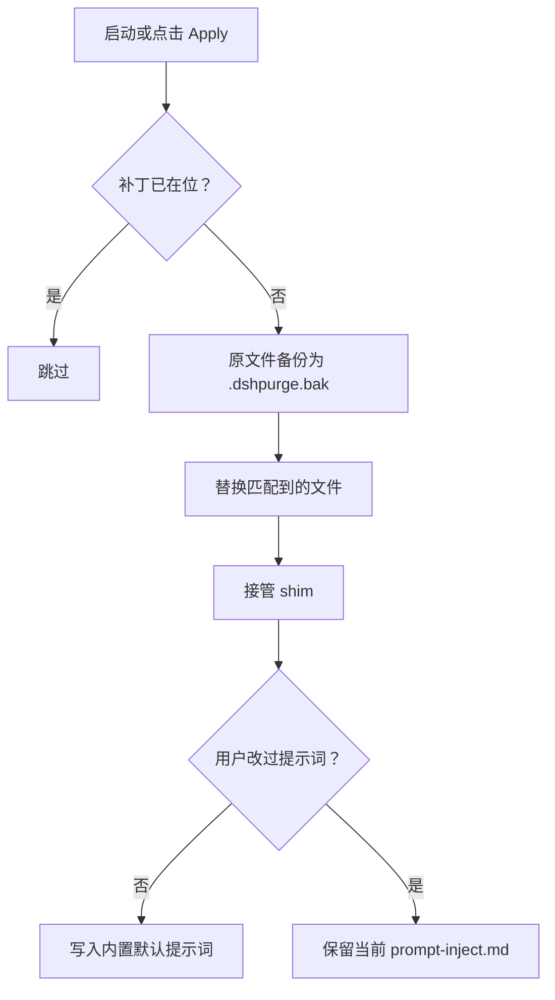
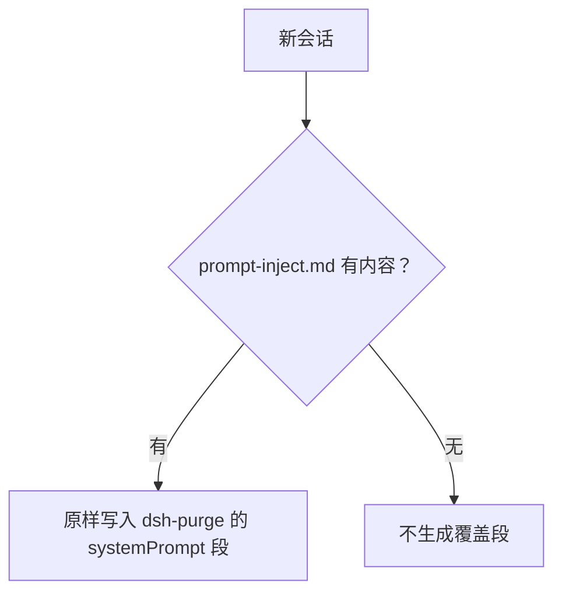

<p align="center">
  
</p>

<h1 align="center">dsh-purge</h1>

<p align="center"><strong>本机 DeepSeek Harness 的可逆改写层</strong></p>

<p align="center">
  
  
  
</p>

> **Apply 之后必须重启宿主，注入才生效。** Apply 只把提示词和补丁写到磁盘，当前进程仍是旧的；宿主重启后新开一个会话，注入才进入上下文。只点 Apply 会看起来像什么都没写进去。

## 这是什么

Harness 不只是转发提示词。它在运行时会重写提示词、审批闸、沙箱策略和会话迁移。只问「模型会不会答」，会把宿主层的拦截误读成模型拒绝。这个插件在你自己的安装上把这两层分开：哪些是模型回的话，哪些是宿主默认策略卡住的。

它只动本机 `@deepseek-ai/*` 的已安装文件和 harness home 里的覆盖文件，不改 Harness 源码树，不做对外扫描，也不是打第三方站点的工具。

| 能力 | 说明 |
|---|---|
| **补丁引擎** | 38 个改写点，分提示词 / 代码 / 工具 / 版本兼容四组。只替换匹配到的原文，匹配不上标 pending 或 skipped，不盲改 |
| **备份与回滚** | 首次改写前留 `<文件>.dshpurge.bak`；回滚时拷回并删备份。没有备份就只剥离本插件写进去的 shim 行 |
| **注入文件** | `$DSH_HOME/prompt-inject.md` 是用户文件，每个会话原样写进 `dsh-purge` 的 systemPrompt 段；文件为空就不写这一段 |
| **面板** | 设置页内嵌补丁状态、Apply / Restore / Uninstall、提示词编辑器 |
| **路由鉴权** | 面板所有路由先过宿主的 `connection.requestRejection()`，签名不符或没 Origin 的请求直接 401 |
| **断流恢复** | 上游流断或会话中断时按配置自动重试与续接 |

## 环境

- dsh **0.2.0-rc.2**（0.1.7-rc.1 起的原文匹配仍然有效）
- Node.js **≥18**；Windows 免闪窗 hook 需要 **≥22**
- 只作用于本机安装：`@deepseek-ai/*` 包与 harness home，不碰第三方插件源码

## 安装

```sh
dsh plugin --profile web add dsh-purge
```

装完还有三步，缺一条都不生效：

1. **退出并重开宿主**——停掉 `dsh web` 再起，或退出桌面端再打开
2. 在那个宿主的**设置页**等 **Rules** 出现，点 **Apply**（页面被缓存就 Ctrl+F5）
3. 按提示**再重启一次**，被改的文件在下次启动时才加载

三个宿主面是独立的：`web`（官方 `dsh web`）、`desktop`（社区桌面端）、`default`（官方 Harness 桌面 EXE）。装到哪个面就只对那个面 Apply，别拿 web 的控制去点桌面端。

## 用法

```sh
dsh-purge --status
dsh-purge --apply
dsh-purge --revert
dsh-purge --uninstall
dsh-purge --edit

/purge status | apply | revert | uninstall | edit | help
/rules list | use <id> | create <id> | delete <id> | reset | help
/skills list | import <zip-or-folder> | create <id> [description] | delete <id> | help
/rewind

purge_status   purge_apply   purge_revert
```

被改过的包只在重启后加载。Apply 自己不重启。面板里 **Stable** 与 **Beta** 是两条独立通道，各有版本列表和切换动作；回退会钉住版本，点 **Update** 才回到该通道最新。

输入框的 **Undo** 丢掉最后一轮并把最后一句用户话放回输入框；主 agent 上可以回退一次或整轮（含子 agent）。回退后只发框里现在的内容。`/rewind` 等价。

## 工作原理

Apply（启动时或点击时）：



每个会话的覆盖：



技能不进入注入段：


## 恢复

- 每个目标在首次 Apply 前拷成 `<文件>.dshpurge.bak`
- **Restore** 或 `/purge revert` 把备份拷回并删掉备份；没有备份时，剥离本插件写进 shim 的行
- `prompt-inject.md` 属于用户文件，始终保留
- **Uninstall** 先还原（如果改过），再删注入文件、规则库和插件自身
- Apply 是幂等的

## 路径检测

先判宿主面：`web` / `desktop`（`gui` / `tui` 保留，仍回落到 web）。

**Web：**

1. `DSH_HOME` / `DSH_BASE`
2. dsh 启动器旁的 `.dsh`（便携安装，不写死盘符）
3. `npm prefix -g` / `npm root -g`
4. 嵌套的 `@deepseek-ai/dsh/node_modules/@deepseek-ai`
5. `~/.dsh`

**社区桌面端：** 只认**正在运行的桌面进程**的安装树（`resources/app` 或 `app.asar.unpacked` → `@deepseek-ai`），目录名不必叫 `DSH Desktop`，盘符不写死。

npm 全局安装默认不碰。密封的 `host-commands` / `runtime-commands` 只清洗、不注入。

找不到就设 `DSH_BASE` / `DSH_DESKTOP_INSTALL`。找不到时不动任何文件。

## 目录

```
dsh-purge/
├── bin/dsh-purge.js
├── client.js
├── cordis.patch.yml
├── docs/
│   ├── banner.svg
│   └── preview/
├── lib/
│   ├── core.js
│   ├── index.js
│   ├── identity.js
│   ├── rules.js
│   ├── skills.js
│   ├── rewind.js
│   ├── update.js
│   ├── hide-console.js
│   ├── restart-web.js
│   └── uninstall.js
├── package.json
└── LICENSE
```

运行时用户文件：`$DSH_HOME/prompt-inject.md`、`$DSH_HOME/rules/`、`$DSH_HOME/skills/`。`DSH_HOME` 未设时，启动器旁的 `.dsh` 优先于 `~/.dsh`。技能不属于 `dsh-purge` 注入段，也不替代提示词。

## 本地检查

```sh
node --check lib/index.js
node --check lib/core.js
node --check lib/surface.js
node --check lib/web.js
node --check lib/desktop.js
node --check lib/host.js
node --check lib/rewind.js
node --check lib/skills.js
node --check client.js
```

## 注意

- 作用范围是本机 `@deepseek-ai/*` 包里的文案、默认值与运行时逻辑，加上 harness home 下的覆盖文件与规则集
- 宿主升级后，匹配不上的原文显示为 skipped；Apply 仍会完成，那些文件原样不动
- 更新通道在本分支已关闭（`lib/update.js` 的 `SELF_HOSTED`），面板点更新只会提示本地自持

## 许可

MIT，见 [LICENSE](LICENSE)。
